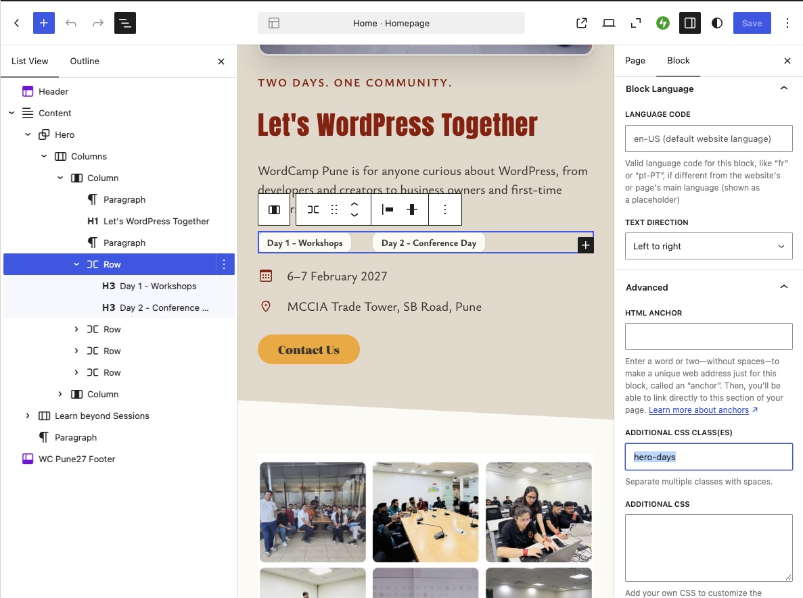
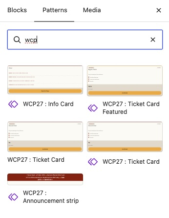

# WordCamp Pune 2027: editor guide

For organizers who edit the site in WordPress. You don't need GitHub or any code. Developer notes are in the [README](../README.md).

**Rule of thumb:** change things in the editor first. The site's extra CSS only handles what the editor can't do, so if something looks wrong, check the editor setting before asking for a CSS change.

## Colours
- Use the **theme swatches** only, never a custom colour or a hex code.
- **Don't change the site's colours or edit the swatches.** Colours are managed by the developers. If a colour looks wrong, tell a developer (see [If something breaks](#if-something-breaks)).
- Swatches in use, for reference:

| Swatch | Used for |
|---|---|
| Base | page background, text on maroon |
| Contrast | body text, text on buttons |
| Accent 1 (maroon) | brand, headings, links, footer |
| Accent 2 (saffron) | buttons, link underlines |
| Accent 3 | not used by the site's CSS; the header or hero background may use it (to confirm) |
| Accent 4 | borders on sand |
| Accent 5 | inputs and light panels |

## Spacing and widths
- Pick the **preset** spacing steps, not custom pixel values.
- Content width (640px) and wide width (1280px) are set once in **Site Editor → Styles → Layout**. Don't set widths on individual blocks or templates.
- **Page (with title)** is the template for every page except the homepage. **Page (no title)** is for the homepage only. Full-width sections there use the **Full width** alignment.

## Classes you can add
Select the block, open **Advanced → Additional CSS class(es)**, and type the class.

*Open **List View** (top-left toolbar button) to see how the blocks are nested and pick the right one. Then open the **Block** tab on the right, scroll to **Advanced**, and type the class in **Additional CSS class(es)**. The class in this picture is only an example; use the classes in the table below. Leave the **Additional CSS** box underneath empty.*

| Class | Put it on | What it does |
|---|---|---|
| `hero-wrap` | the homepage hero group | angled bottom edge, hover zoom on the photo, photo above the text on phones |
| `nav-cta` | a header menu item | makes it a saffron button (full width in the phone menu); use it for Contact now and Tickets later |
| `past-wc-nav` | the Past WordCamps menu in the footer | pill-shaped links that wrap to the column width |
| `announce`, `announce__row`, `announce__label` | the announcement strip, its inner Row, and the small pill paragraph | already on the Announcement strip pattern; add them by hand only if you build the strip yourself |
| `error404-image`, `error404-intro`, `error404-search`, `error404-buttons` | blocks in the 404 template | rounded illustration, centred text, search panel, full-width buttons on phones. Used only in the 404 template (Appearance → Editor → Templates → 404) |
| (none) | the Updates page | posts show as a card grid automatically; nothing to add. Applies only to the page set as the Posts page in Settings → Reading |

Don't invent other class names. They won't have styles.

## Ready-made patterns
Insert these from the block inserter → **Patterns** instead of building them by hand. Type `wcp` in the search box to list only ours; every name starts with `WCP27 : `. Edit the text, links and swatches; don't change the class names.

| Pattern | Use it for |
|---|---|
| WCP27 : Announcement strip | one fact at the top of the homepage, such as "Early-bird closes 30 November". Edit the small label ("Tickets", "Speakers") and the sentence; the arrow after the link is added for you |
| WCP27 : Ticket Card, WCP27 : Ticket Card Featured | one card per ticket type; use the Featured version for the recommended one |
| WCP27 : Info Card | venue, travel and contact details, one card per topic (Venue, Getting here, Contact). Edit the heading, the labels and values, and the button link |

## Common tasks
Jump to: [menu item](#add-a-menu-item) · [button](#add-a-button) · [news post](#add-a-news-post) · [ticket card](#add-a-ticket-card) · [info card](#add-an-info-card) · [test safely](#test-a-change-safely) · [report a bug](#report-a-visual-bug)

### Add a menu item
Open the **Header** template part in the Site Editor, select the **Navigation** block, and in the **Block** tab on the right use the list of links (first tab) and click **+** to add the link. Add `nav-cta` only for the one main button.

### Add a button
Add a Buttons block. Use **Fill** for the main action and **Outline** for the second one. Don't set a custom colour on the button, because the site sets button colours itself and overrides yours.

### Add a news post
Posts → Add New. Add a featured image, a category and a short opening paragraph. Search results show it with a "News" label, and it appears as a card on the Updates page.

### Add a ticket card
Open the page → block inserter → **Patterns** → search `wcp` → **WCP27 : Ticket Card**. Edit the text, price and button link. Add `ticket-card-featured` in **Advanced → Additional CSS class(es)** on the card you want to recommend.

### Add an info card
Block inserter → **Patterns** → search `wcp` → **WCP27 : Info Card**. One card per topic (Venue, Getting here, Contact). Edit the heading, the label and value rows, and the button link. If the pattern isn't in the inserter yet, ask a developer (it is still pending in the Site Editor).

### Test a change safely
1. Try it on the password-protected [test page](#test-page-and-test-post), not on a live page.
2. Preview on desktop and on a phone width (about 390px).
3. Check the header, and that every button is a rounded pill.
4. Don't publish to test. Use **Visibility → Private** while you try things, then trash the draft.

### Report a visual bug
See [If something breaks](#if-something-breaks).

## Things that look like bugs but aren't
- **Header doesn't shrink on scroll.** It stays sticky and compact on purpose. The shrink effect can't be done in the site's CSS.
- **Scroll animations.** They don't work on WordCamp.org. Images zoom on hover instead.
- **Subscribe field looks faded or pink when you're logged in.** Jetpack fills in your email. Visitors don't see it.
- **Your CSS in Appearance → Additional CSS has no effect, or fights the site.** Leave that screen empty. All CSS lives in the repo.
- **Search results show a short description.** The template prints the full content, and the CSS trims it to three lines.

## Test page and test post
Two items for trying out styling. The page is **password-protected** (ask a developer for the password) and the post is **private**, so only people with the password or a login can see them. Leave them that way.

- Test page: https://pune.wordcamp.org/2027/test-page-for-testing-our-styling/
- Test post: https://pune.wordcamp.org/2027/test-post-to-check-styling/

Use them before and after a styling change. Look at them at desktop width and at about 390px:
- header stays at the top, and nothing hides under it
- links, Fill and Outline buttons (rounded pills, no coloured block behind them)
- headings, lists, quote and table
- the post's date, categories and tags
- spacing above the footer, and the footer's search and Subscribe form

Add new block types to them as you start using those blocks on the site. Don't publish them or put real content on them.

## Where changes go
| You want to change | Where |
|---|---|
| Text, images, menus, page layout | the editor |
| A colour, across the site | ask a developer; organizers don't change colours |
| Widths and spacing | Site Editor → Styles → Layout |
| A hover effect, the header, the footer layout, a phone-only fix | ask a developer; it's in the CSS repo |

## If something breaks
1. Note the page, the browser and the screen width (phone, tablet or desktop).
2. Take a screenshot.
3. Send both to a developer. They can check whether it's the editor, the CSS or a plugin update.

Changes to the CSS go live within seconds of being merged, so tell the developers before a big event or announcement.
